# Dreamtex E-commerce Website

Dreamtex is a PHP-based e-commerce website project for promotional clothing, merchandise, and related products. It contains server-rendered page templates, reusable PHP components, responsive styles, and front-end interactions for browsing products, working through a shopping flow, and viewing customer-account pages.

The interface content is primarily in Polish. This repository provides website templates and front-end behavior; it should not be treated as a complete production commerce backend.

## Features

- Public and signed-in homepage layouts
- Product category, product detail, news, article, and content pages
- "Add to cart" configurator modal with colour swatches, per-size quantity steppers, and live net totals
- Product comparison for 2–5 products with "Najważniejsze", "Wszystkie parametry", and "Tylko różnice" views, collapsible parameter groups, and empty and single-product states
- Multi-step cart and offer flows, including future-delivery info tooltips
- Company and individual customer-account page templates with an auto-highlighted sidebar, including a company and user data change request form
- Contact, registration, password-reminder, and 404 error pages
- Responsive layouts implemented with SCSS and CSS, with a dedicated mobile menu and search toggle
- Reusable PHP includes for navigation, page sections, and account content
- Front-end interactions using JavaScript and bundled libraries

## Technology

- PHP templates and includes
- HTML5
- SCSS and CSS
- JavaScript
- Bootstrap
- jQuery
- Swiper
- Select2
- Bootbox

Third-party libraries and assets are included in the repository's `css/`, `js/`, and `webfonts/` directories. Their respective licenses remain applicable; see [Third-party materials](#third-party-materials).

## Requirements

- Apache (or another PHP-capable web server)
- PHP 7.4 or later
- A modern web browser
- XAMPP is a convenient option for local development on Windows

No Composer or npm dependency manifest is included. The project uses the front-end libraries already bundled in the repository.

## Run locally with XAMPP

1. Place the project directory in XAMPP's `htdocs` directory. For example:

   ```text
   C:\xampp\htdocs\DREAMTEXNEW
   ```

2. Start Apache from the XAMPP Control Panel.
3. Open the local homepage in a browser:

   ```text
   http://localhost/DREAMTEXNEW/
   ```

4. Open any page listed in [Page catalogue](#page-catalogue) by appending its relative path.

The pages use PHP includes and therefore need to be served through Apache/PHP; opening the files directly from the filesystem will not render them correctly. No database setup is documented or supplied with this project. Some screens may display illustrative or sample content and should not be assumed to persist data or complete real transactions.

## Project structure

```text
.
├── assets/                 Images, icons, and other visual assets
├── components/             Reusable PHP page sections, grouped by feature
│   ├── account_panel/
│   ├── article/
│   ├── auth_pages/
│   ├── cart/
│   ├── category/
│   ├── common/
│   ├── compare/
│   ├── contact_page/
│   ├── content_page/
│   ├── error_page/
│   ├── main_page/
│   ├── news/
│   ├── offerts_page/
│   ├── offerts_steps/
│   ├── product-card/
│   ├── register/
│   └── storage/
├── css/                    Bundled third-party CSS
├── js/                     Front-end scripts and bundled libraries
├── screenshots/            Desktop and mobile screenshots used in this README
├── scss/                   Project stylesheets and compiled main.css
├── webfonts/               Font files
├── *.php                   Top-level page entry points
├── LICENSE.md              Project copyright and usage terms
└── README.md
```

Top-level PHP files are page entry points. Most reusable page markup lives under `components/` and is included by those entry points. The stylesheet linked by the pages is `scss/main.css`; its source styles are organized in `scss/`.

## Screenshots

Desktop screenshots are captured at 1920 × 1080 and mobile screenshots at 390 × 844 (2× pixel density). Click any image to open it at full size.

### Storefront

<table>
  <tr>
    <th width="70%">Desktop</th>
    <th width="30%">Mobile</th>
  </tr>
  <tr>
    <td align="center"><a href="./screenshots/home-page-desktop.jpg"></a></td>
    <td align="center"><a href="./screenshots/home-page-mobile.jpg"></a></td>
  </tr>
  <tr>
    <td colspan="2" align="center"><b>Home page</b> — Hero slider, featured categories, and news for guest visitors. <sub>(<a href="./index.php"><code>index.php</code></a>)</sub></td>
  </tr>
  <tr>
    <td align="center"><a href="./screenshots/home-page-logged-desktop.jpg"></a></td>
    <td align="center"><a href="./screenshots/home-page-logged-mobile.jpg"></a></td>
  </tr>
  <tr>
    <td colspan="2" align="center"><b>Home page — signed in</b> — Header variant with account shortcuts for a signed-in customer. <sub>(<a href="./index-logged-user.php"><code>index-logged-user.php</code></a>)</sub></td>
  </tr>
  <tr>
    <td align="center"><a href="./screenshots/category-desktop.jpg">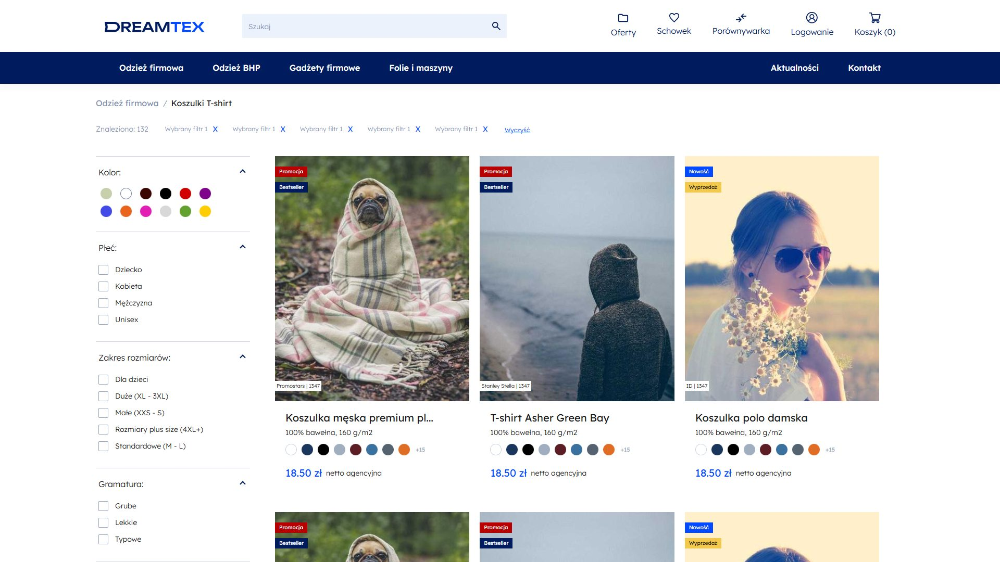</a></td>
    <td align="center"><a href="./screenshots/category-mobile.jpg"></a></td>
  </tr>
  <tr>
    <td colspan="2" align="center"><b>Product category</b> — Product grid with filters, sorting, and view toggles. <sub>(<a href="./category.php"><code>category.php</code></a>)</sub></td>
  </tr>
  <tr>
    <td align="center"><a href="./screenshots/category-empty-desktop.jpg">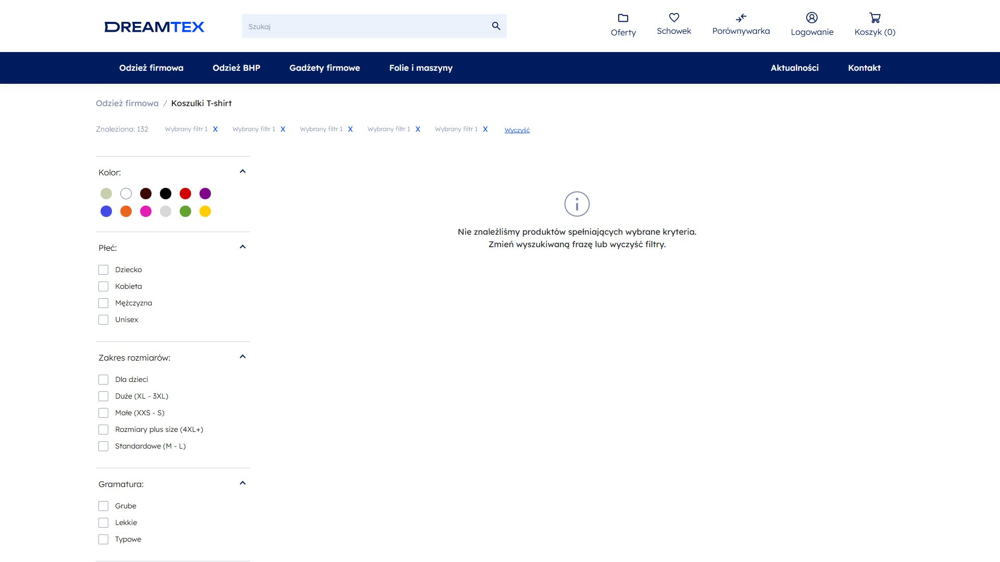</a></td>
    <td align="center"><a href="./screenshots/category-empty-mobile.jpg"></a></td>
  </tr>
  <tr>
    <td colspan="2" align="center"><b>Empty category results</b> — Fallback shown when no products match the selected filters. <sub>(<a href="./category-empty-result.php"><code>category-empty-result.php</code></a>)</sub></td>
  </tr>
</table>

### Product and cart

<table>
  <tr>
    <th width="70%">Desktop</th>
    <th width="30%">Mobile</th>
  </tr>
  <tr>
    <td align="center"><a href="./screenshots/product-card-desktop.jpg">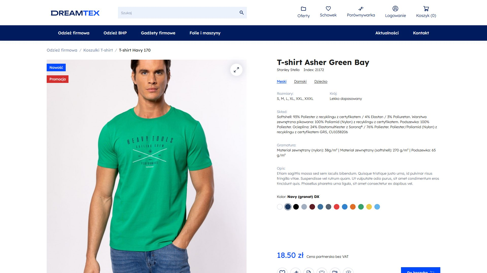</a></td>
    <td align="center"><a href="./screenshots/product-card-mobile.jpg">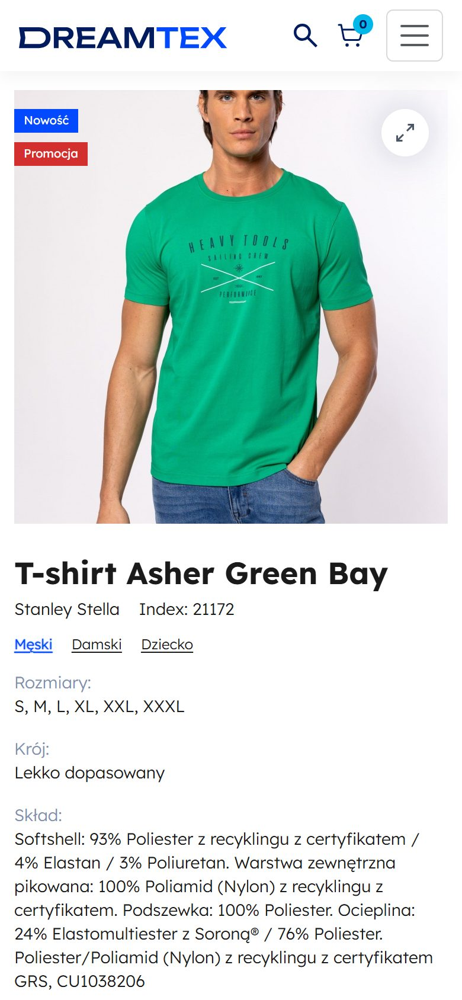</a></td>
  </tr>
  <tr>
    <td colspan="2" align="center"><b>Product page</b> — Product gallery, specifications, colour selection, price, and quick actions. <sub>(<a href="./product-card.php"><code>product-card.php</code></a>)</sub></td>
  </tr>
  <tr>
    <td align="center"><a href="./screenshots/product-card-modal-desktop.jpg">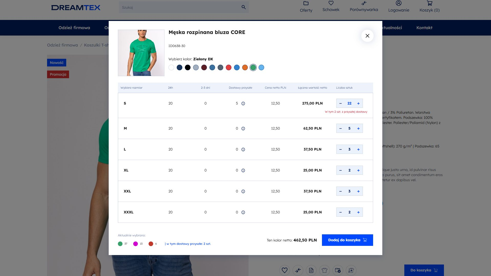</a></td>
    <td align="center"><a href="./screenshots/product-card-modal-mobile.jpg">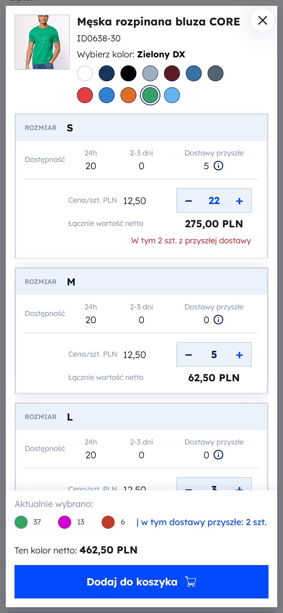</a></td>
  </tr>
  <tr>
    <td colspan="2" align="center"><b>Add-to-cart configurator</b> — Modal with colour swatches, per-size stock, quantity steppers, and net totals. <sub>(<a href="./product-card.php"><code>product-card.php</code></a>)</sub></td>
  </tr>
  <tr>
    <td align="center"><a href="./screenshots/cart-step-one-desktop.jpg">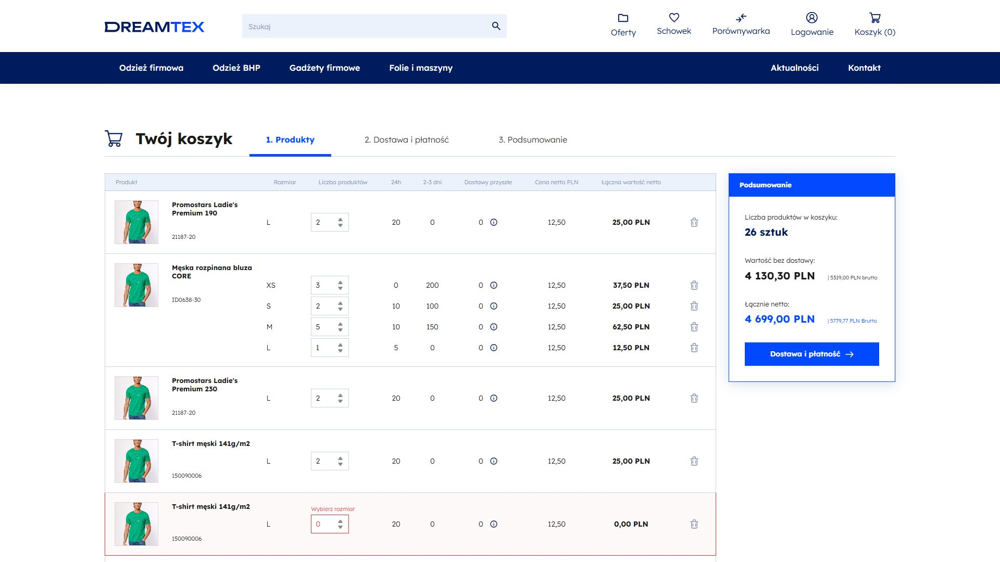</a></td>
    <td align="center"><a href="./screenshots/cart-step-one-mobile.jpg">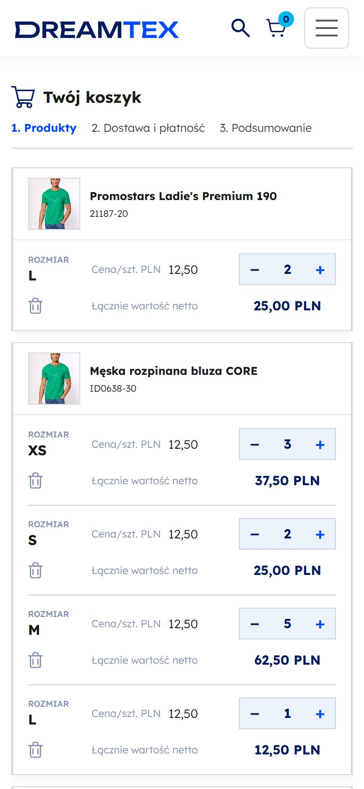</a></td>
  </tr>
  <tr>
    <td colspan="2" align="center"><b>Cart — step 1: products</b> — Products grouped by size, with quantity steppers and line totals. <sub>(<a href="./cart-step-one.php"><code>cart-step-one.php</code></a>)</sub></td>
  </tr>
  <tr>
    <td align="center"><a href="./screenshots/cart-step-two-desktop.jpg">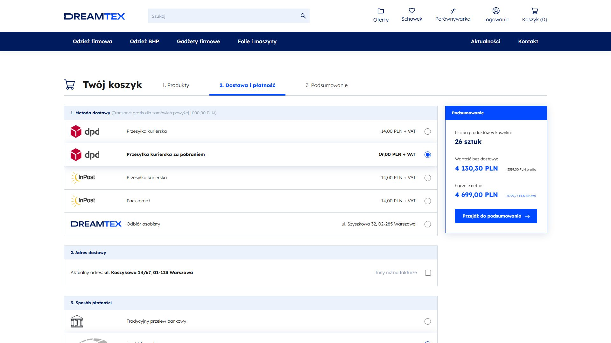</a></td>
    <td align="center"><a href="./screenshots/cart-step-two-mobile.jpg">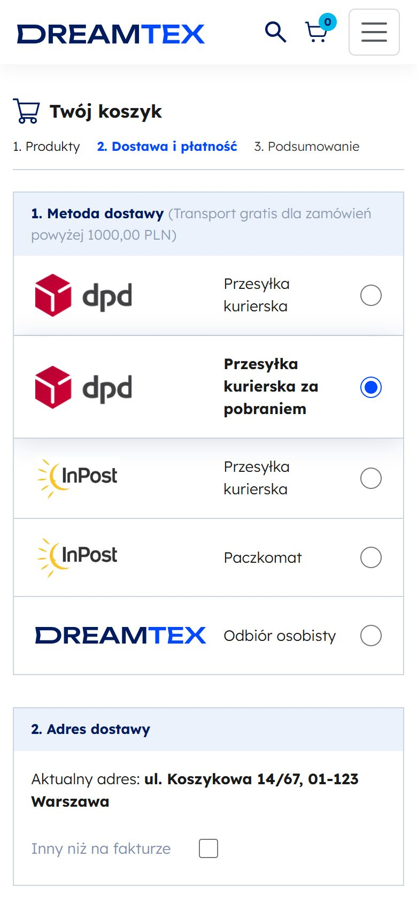</a></td>
  </tr>
  <tr>
    <td colspan="2" align="center"><b>Cart — step 2: delivery and payment</b> — Shipping method, delivery address, payment method, and order summary. <sub>(<a href="./cart-step-two.php"><code>cart-step-two.php</code></a>)</sub></td>
  </tr>
  <tr>
    <td align="center"><a href="./screenshots/cart-step-three-desktop.jpg">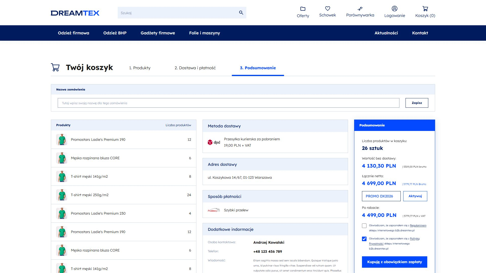</a></td>
    <td align="center"><a href="./screenshots/cart-step-three-mobile.jpg">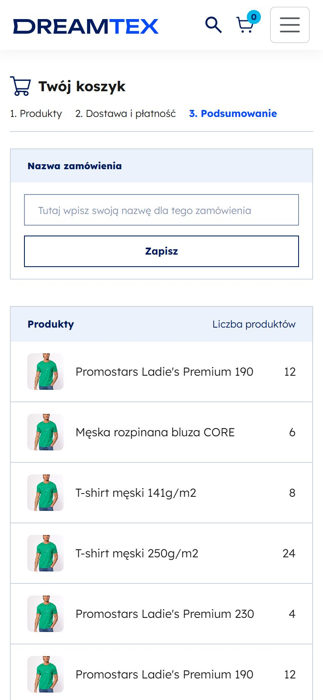</a></td>
  </tr>
  <tr>
    <td colspan="2" align="center"><b>Cart — step 3: summary</b> — Order review with products, delivery, payment, discount code, and terms acceptance. <sub>(<a href="./cart-step-three.php"><code>cart-step-three.php</code></a>)</sub></td>
  </tr>
</table>

### Product comparison

<table>
  <tr>
    <th width="70%">Desktop</th>
    <th width="30%">Mobile</th>
  </tr>
  <tr>
    <td align="center"><a href="./screenshots/compare-desktop.jpg">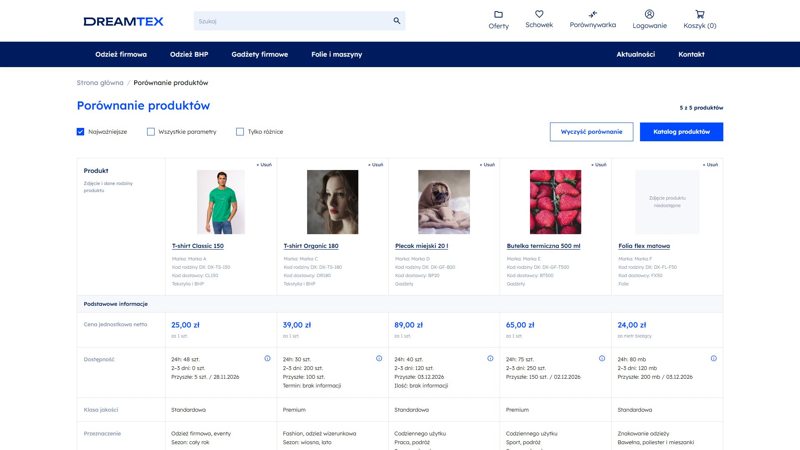</a></td>
    <td align="center"><a href="./screenshots/compare-mobile.jpg"></a></td>
  </tr>
  <tr>
    <td colspan="2" align="center"><b>Product comparison</b> — Five products side by side with key parameters and collapsible groups for the rest. <sub>(<a href="./compare.php"><code>compare.php</code></a>)</sub></td>
  </tr>
  <tr>
    <td align="center"><a href="./screenshots/compare-differences-desktop.jpg">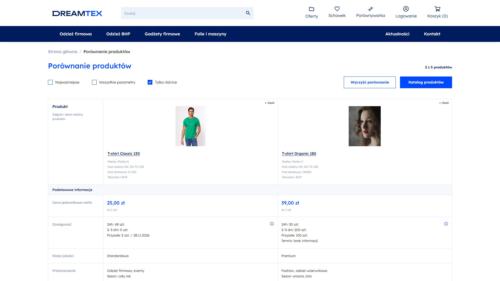</a></td>
    <td align="center"><a href="./screenshots/compare-differences-mobile.jpg">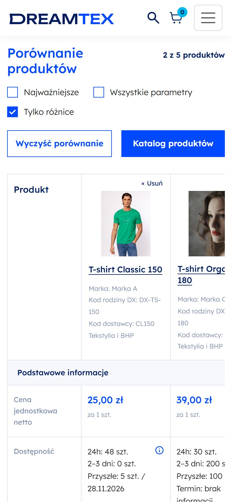</a></td>
  </tr>
  <tr>
    <td colspan="2" align="center"><b>Product comparison — differences only</b> — Identical rows hidden and groups with differences expanded. <sub>(<a href="./compare-two-products.php?mode=diff"><code>compare-two-products.php?mode=diff</code></a>)</sub></td>
  </tr>
  <tr>
    <td align="center"><a href="./screenshots/compare-one-product-desktop.jpg">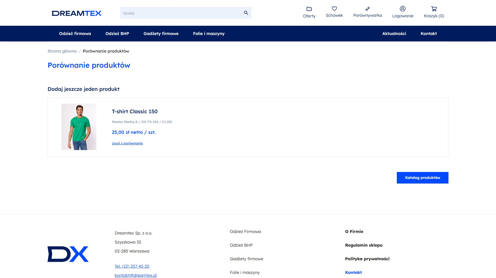</a></td>
    <td align="center"><a href="./screenshots/compare-one-product-mobile.jpg">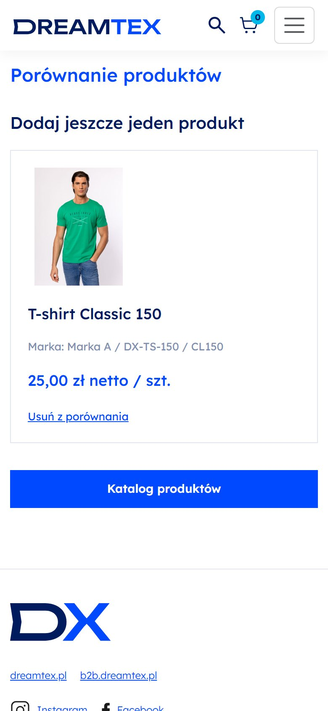</a></td>
  </tr>
  <tr>
    <td colspan="2" align="center"><b>Product comparison — one product</b> — Selected product with a prompt to add one more. <sub>(<a href="./compare-one-product.php"><code>compare-one-product.php</code></a>)</sub></td>
  </tr>
  <tr>
    <td align="center"><a href="./screenshots/compare-empty-desktop.jpg">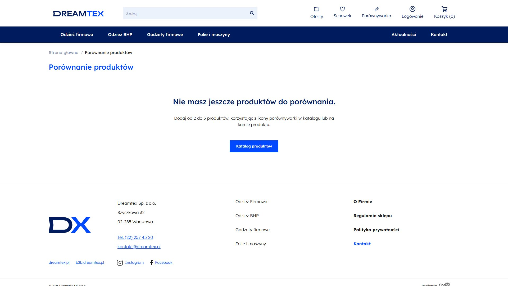</a></td>
    <td align="center"><a href="./screenshots/compare-empty-mobile.jpg"></a></td>
  </tr>
  <tr>
    <td colspan="2" align="center"><b>Product comparison — empty</b> — Shown when no products have been added yet. <sub>(<a href="./compare-empty.php"><code>compare-empty.php</code></a>)</sub></td>
  </tr>
</table>

### Offers

<table>
  <tr>
    <th width="70%">Desktop</th>
    <th width="30%">Mobile</th>
  </tr>
  <tr>
    <td align="center"><a href="./screenshots/offerts-list-desktop.jpg">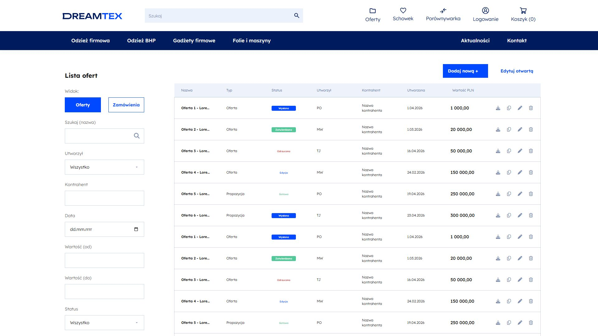</a></td>
    <td align="center"><a href="./screenshots/offerts-list-mobile.jpg">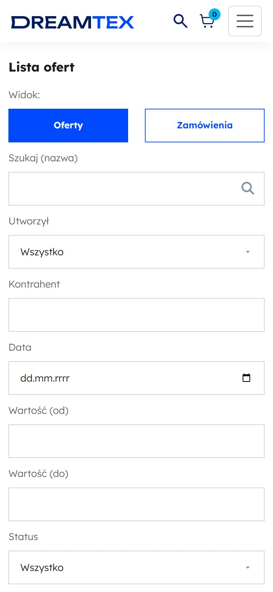</a></td>
  </tr>
  <tr>
    <td colspan="2" align="center"><b>Offers list</b> — Offers and orders table with filters, status badges, and quick actions. <sub>(<a href="./offerts-list.php"><code>offerts-list.php</code></a>)</sub></td>
  </tr>
  <tr>
    <td align="center"><a href="./screenshots/offerts-list-step-two-desktop.jpg">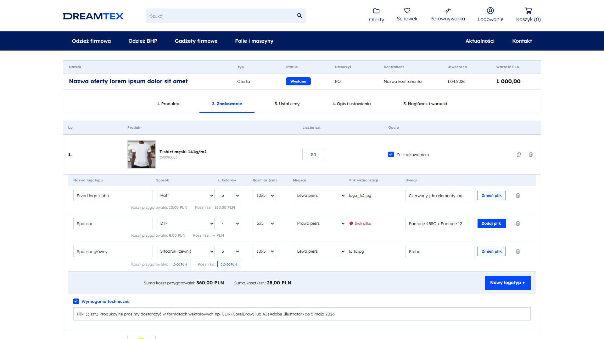</a></td>
    <td align="center"><a href="./screenshots/offerts-list-step-two-mobile.jpg">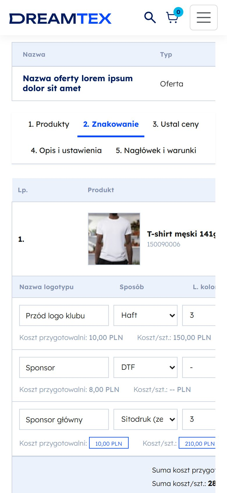</a></td>
  </tr>
  <tr>
    <td colspan="2" align="center"><b>Offer builder — step 2: branding</b> — Logo placement, decoration technique, size, visualisation files, and costs. <sub>(<a href="./offerts-list-step-two.php"><code>offerts-list-step-two.php</code></a>)</sub></td>
  </tr>
</table>

### Customer account

<table>
  <tr>
    <th width="70%">Desktop</th>
    <th width="30%">Mobile</th>
  </tr>
  <tr>
    <td align="center"><a href="./screenshots/my-orders-desktop.jpg">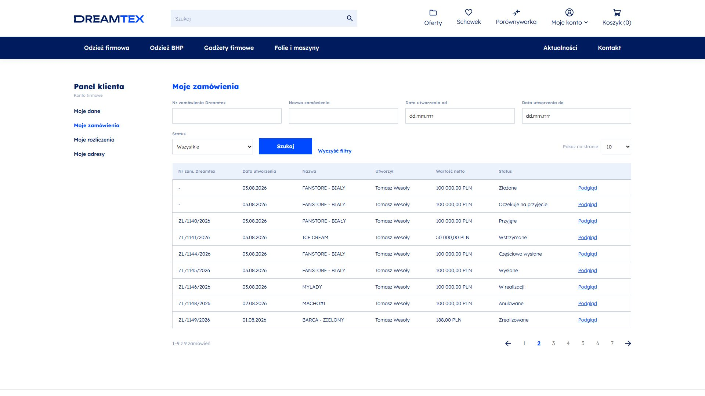</a></td>
    <td align="center"><a href="./screenshots/my-orders-mobile.jpg">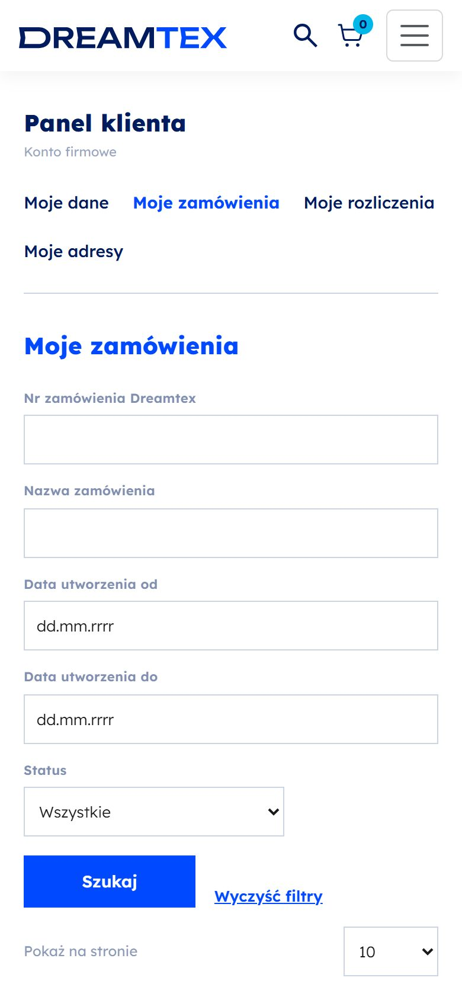</a></td>
  </tr>
  <tr>
    <td colspan="2" align="center"><b>My orders</b> — Order history table with statuses and actions. <sub>(<a href="./my-orders.php"><code>my-orders.php</code></a>)</sub></td>
  </tr>
  <tr>
    <td align="center"><a href="./screenshots/my-order-details-desktop.jpg">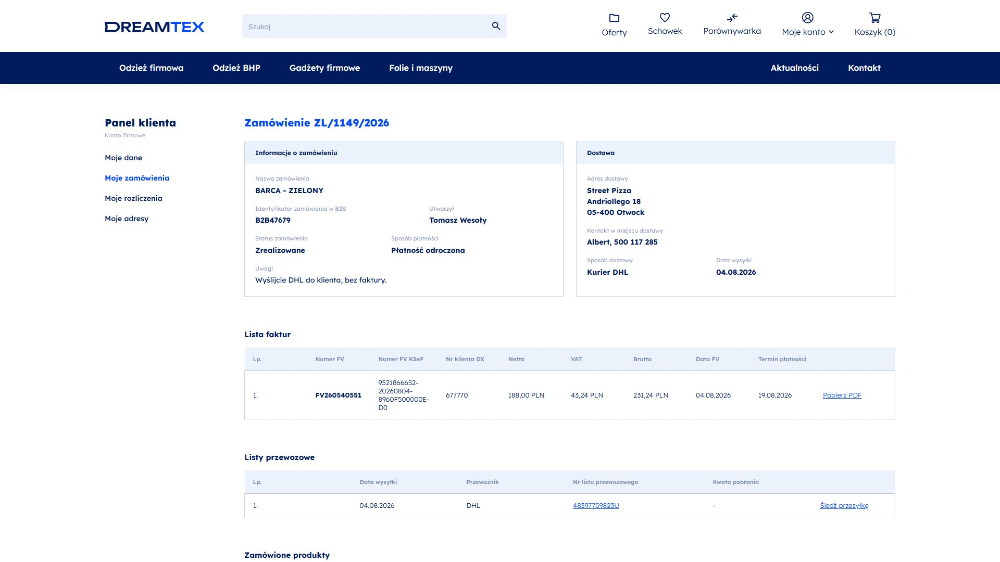</a></td>
    <td align="center"><a href="./screenshots/my-order-details-mobile.jpg"></a></td>
  </tr>
  <tr>
    <td colspan="2" align="center"><b>Order details</b> — Order information, delivery details, invoices, waybills, and ordered products. <sub>(<a href="./my-order-details.php"><code>my-order-details.php</code></a>)</sub></td>
  </tr>
  <tr>
    <td align="center"><a href="./screenshots/my-data-desktop.jpg">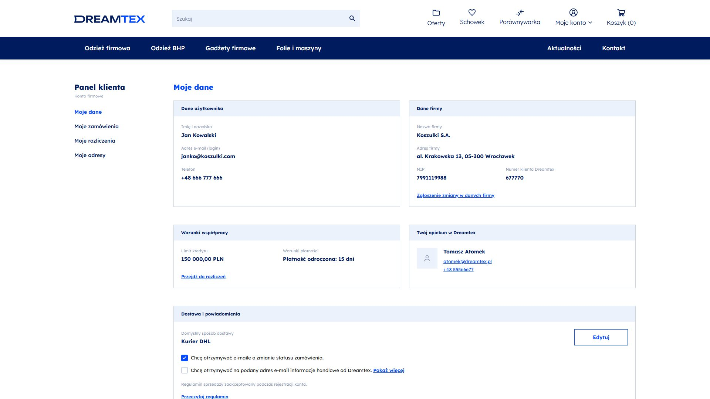</a></td>
    <td align="center"><a href="./screenshots/my-data-mobile.jpg">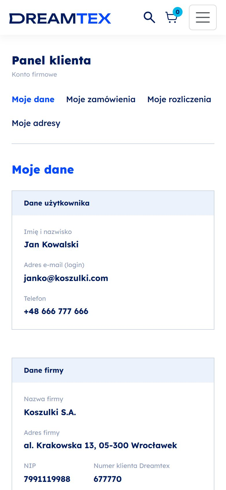</a></td>
  </tr>
  <tr>
    <td colspan="2" align="center"><b>My data</b> — User and company details, credit terms, account manager, and notification settings. <sub>(<a href="./my-data.php"><code>my-data.php</code></a>)</sub></td>
  </tr>
</table>

### Other pages

<table>
  <tr>
    <th width="70%">Desktop</th>
    <th width="30%">Mobile</th>
  </tr>
  <tr>
    <td align="center"><a href="./screenshots/register-desktop.jpg">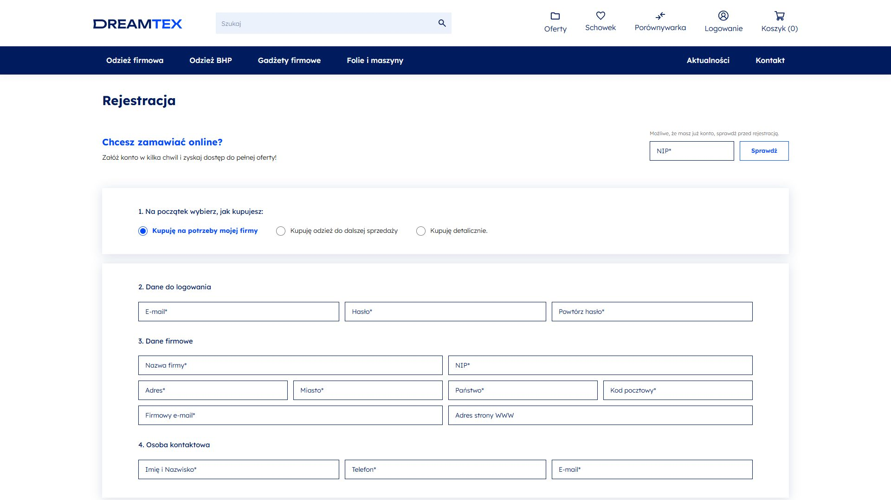</a></td>
    <td align="center"><a href="./screenshots/register-mobile.jpg"></a></td>
  </tr>
  <tr>
    <td colspan="2" align="center"><b>Registration</b> — Business registration form with buyer type, login, company, and contact details. <sub>(<a href="./register.php"><code>register.php</code></a>)</sub></td>
  </tr>
  <tr>
    <td align="center"><a href="./screenshots/contact-desktop.jpg">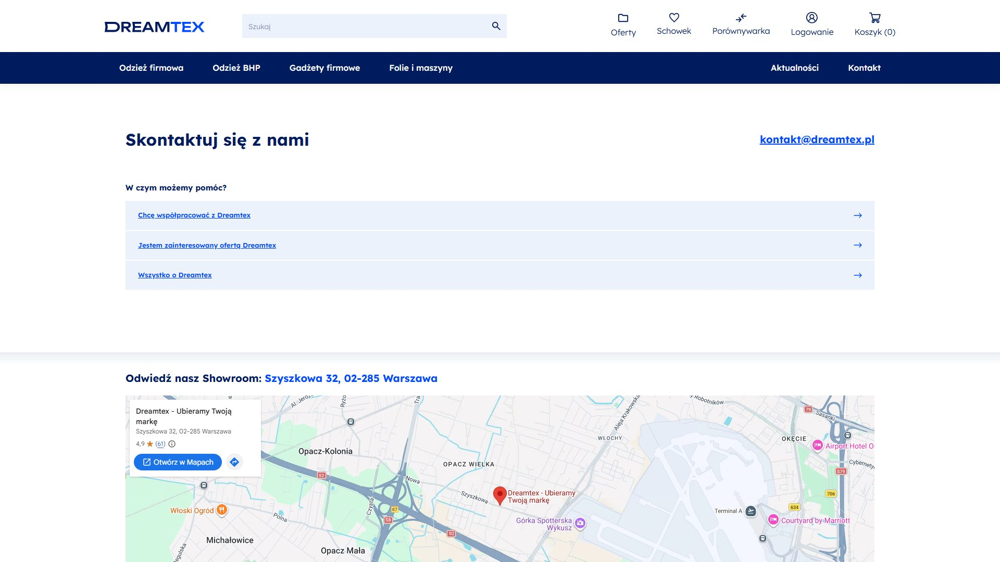</a></td>
    <td align="center"><a href="./screenshots/contact-mobile.jpg"></a></td>
  </tr>
  <tr>
    <td colspan="2" align="center"><b>Contact</b> — Help topics, contact e-mail, and showroom location map. <sub>(<a href="./contact-unlogged.php"><code>contact-unlogged.php</code></a>)</sub></td>
  </tr>
  <tr>
    <td align="center"><a href="./screenshots/news-desktop.jpg">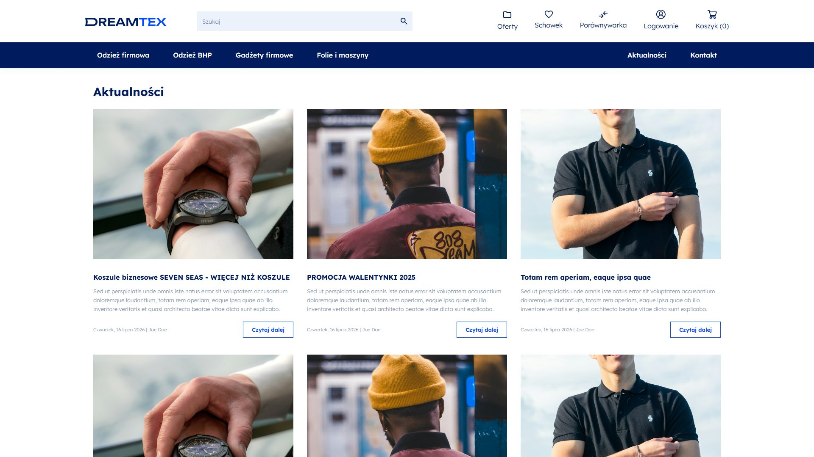</a></td>
    <td align="center"><a href="./screenshots/news-mobile.jpg"></a></td>
  </tr>
  <tr>
    <td colspan="2" align="center"><b>News</b> — News listing with article cards. <sub>(<a href="./news.php"><code>news.php</code></a>)</sub></td>
  </tr>
  <tr>
    <td align="center"><a href="./screenshots/article-desktop.jpg"></a></td>
    <td align="center"><a href="./screenshots/article-mobile.jpg"></a></td>
  </tr>
  <tr>
    <td colspan="2" align="center"><b>Article</b> — Article page with related news and products. <sub>(<a href="./article.php"><code>article.php</code></a>)</sub></td>
  </tr>
  <tr>
    <td align="center"><a href="./screenshots/wishlist-desktop.jpg">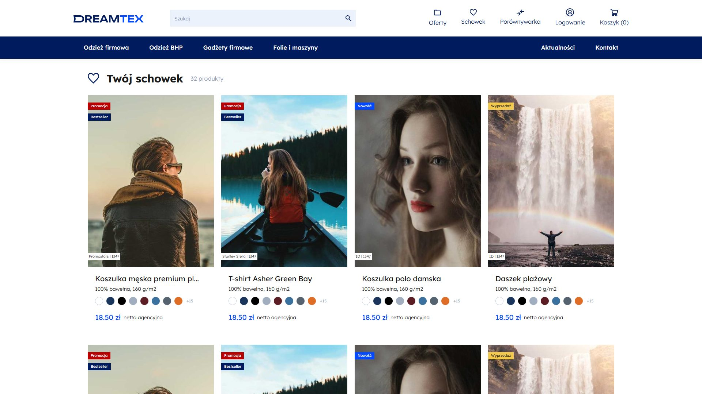</a></td>
    <td align="center"><a href="./screenshots/wishlist-mobile.jpg">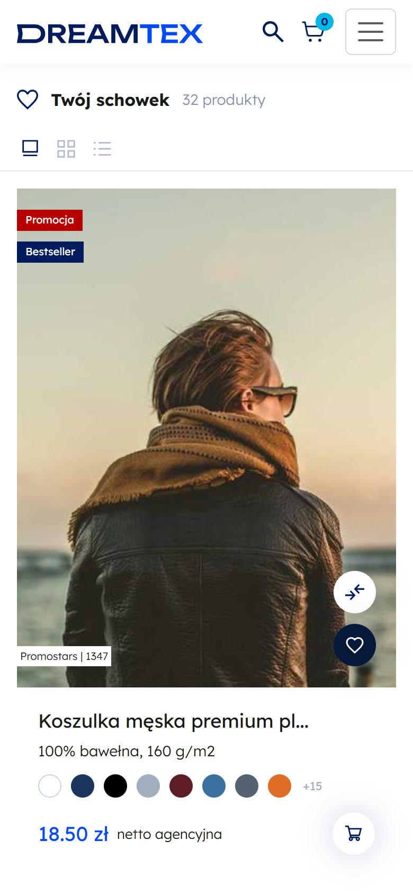</a></td>
  </tr>
  <tr>
    <td colspan="2" align="center"><b>Wishlist</b> — Saved products grid with badges, colour swatches, and prices. <sub>(<a href="./storage.php"><code>storage.php</code></a>)</sub></td>
  </tr>
  <tr>
    <td align="center"><a href="./screenshots/404-desktop.jpg">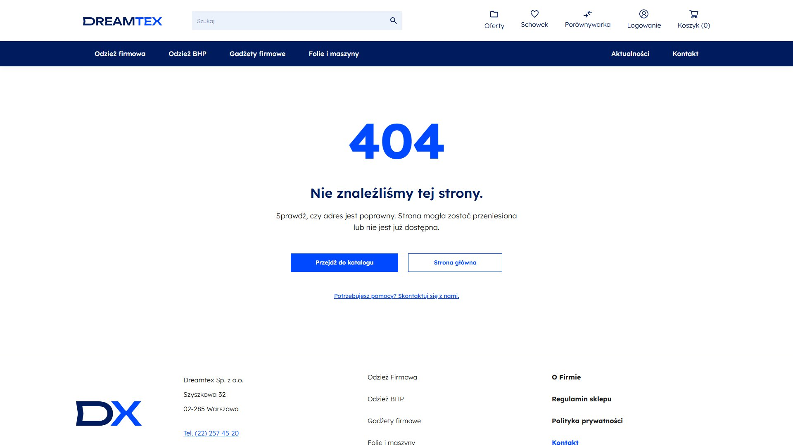</a></td>
    <td align="center"><a href="./screenshots/404-mobile.jpg"></a></td>
  </tr>
  <tr>
    <td colspan="2" align="center"><b>Page not found</b> — 404 error page with links to the catalogue, home page, and contact. <sub>(<a href="./404.php"><code>404.php</code></a>)</sub></td>
  </tr>
</table>

## Page catalogue

### Home and catalogue

- Home page: [`index.php`](./index.php)
- Home page for a signed-in user: [`index-logged-user.php`](./index-logged-user.php)
- Product category: [`category.php`](./category.php)
- Empty category results: [`category-empty-result.php`](./category-empty-result.php)
- Product details: [`product-card.php`](./product-card.php)
- Wishlist (saved products): [`storage.php`](./storage.php)

### Product comparison

- Five products: [`compare.php`](./compare.php)
- Two products: [`compare-two-products.php`](./compare-two-products.php)
- One product: [`compare-one-product.php`](./compare-one-product.php)
- No products: [`compare-empty.php`](./compare-empty.php)

The starting view of the table pages can be set with `?mode=important` (default), `?mode=all`, or `?mode=diff`.

### Cart

- Cart — products: [`cart-step-one.php`](./cart-step-one.php)
- Cart — delivery and payment: [`cart-step-two.php`](./cart-step-two.php)
- Cart — summary: [`cart-step-three.php`](./cart-step-three.php)

### Offers

- Offers list: [`offerts-list.php`](./offerts-list.php)
- Offer flow — step 1: [`offerts-list-step-one.php`](./offerts-list-step-one.php)
- Offer flow — step 2: [`offerts-list-step-two.php`](./offerts-list-step-two.php)
- Offer flow — step 3: [`offerts-list-step-three.php`](./offerts-list-step-three.php)
- Offer flow — step 4: [`offerts-list-step-four.php`](./offerts-list-step-four.php)
- Offer flow — step 5: [`offerts-list-step-five.php`](./offerts-list-step-five.php)

### Customer account — company

- Personal data: [`my-data.php`](./my-data.php)
- Data change request: [`my-data-change-request.php`](./my-data-change-request.php)
- Orders: [`my-orders.php`](./my-orders.php)
- Order details: [`my-order-details.php`](./my-order-details.php)
- Billing: [`my-billing.php`](./my-billing.php)
- Addresses: [`my-addresses.php`](./my-addresses.php)
- Address form: [`my-addresses-form.php`](./my-addresses-form.php)

### Customer account — individual

- Personal data: [`individual-my-data.php`](./individual-my-data.php)
- Orders: [`individual-my-orders.php`](./individual-my-orders.php)
- Order details: [`individual-order-details.php`](./individual-order-details.php)
- Addresses: [`individual-my-addresses.php`](./individual-my-addresses.php)
- Address form: [`individual-my-addresses-form.php`](./individual-my-addresses-form.php)

### Other pages

- Registration: [`register.php`](./register.php)
- Password reminder: [`remind-password.php`](./remind-password.php)
- Contact: [`contact-unlogged.php`](./contact-unlogged.php)
- Contact for signed-in users: [`contact-logged.php`](./contact-logged.php)
- News: [`news.php`](./news.php)
- Article: [`article.php`](./article.php)
- Universal content page: [`universal-page.php`](./universal-page.php)
- Page not found: [`404.php`](./404.php)

## Development notes

- Keep reusable page sections in the relevant `components/` subdirectory and include them from the top-level PHP page.
- Organize style changes in the appropriate SCSS source file. Ensure the stylesheet served by the pages, `scss/main.css`, is kept in sync.
- Preserve the existing relative asset paths when adding or moving pages.
- The product comparison templates are static HTML with sample products. View switching, collapsible groups, difference detection, hiding parameters without values, and removing products are handled in `js/compare/compare.js`.
- The repository does not currently document an automated build, lint, or test command.

## Third-party materials

The project's custom license applies to original project materials owned by the project copyright holder. It does not replace or override licenses for third-party libraries, fonts, or other materials included in the repository. Review and comply with the applicable license terms for those materials before using them.

## Copyright and license

Original project code and materials are protected by copyright and are **not** released under an open-source or Creative Commons license. All rights are reserved by the project copyright holder. Copying, redistribution, modification, publication, and sublicensing require prior written permission. **Commercial use is prohibited in all cases under these terms.**

See [LICENSE.md](./LICENSE.md) for the full terms. The license does not grant ownership of or rights to third-party materials bundled with the project.
